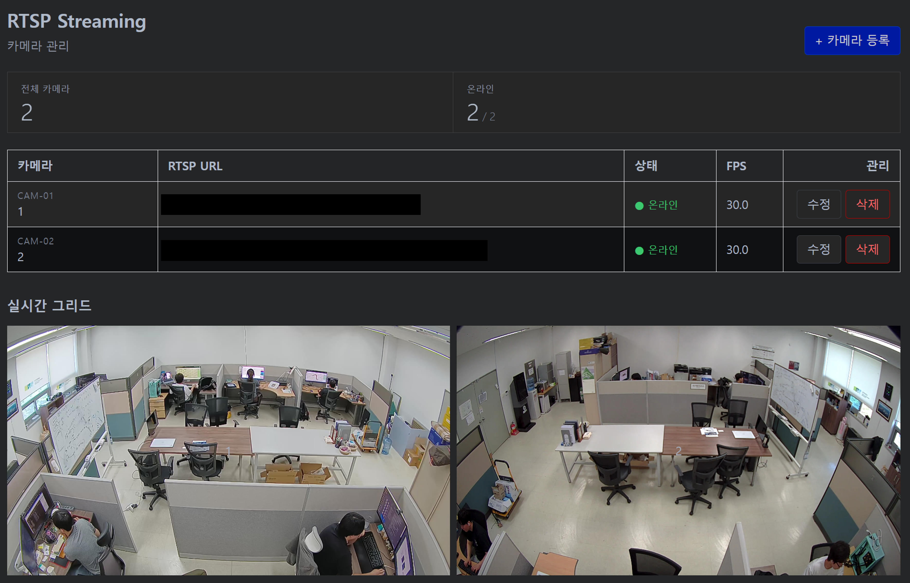

# rtsp-streaming



# 설치 · 실행 (setup 스크립트)

준비물: **Docker** (Linux: Docker Engine + compose 플러그인 · macOS / Windows: Docker Desktop).

```bash
git clone <repo-URL> rtsp-streaming
cd rtsp-streaming
```

| 운영체제 | 실행 |
|---|---|
| Linux · macOS | `./setup.sh` |
| Windows | `setup.cmd` 더블클릭 |

끝나면 브라우저에서 `http://localhost:<FRONTEND_PORT>` 로 접속.

---

RTSP 카메라를 등록·수정·삭제하고, MediaMTX가 모든 코덱(H.264/H.265/MJPEG 등)을 H.264로 transcode해 브라우저에 WebRTC(WHEP)로 실시간 스트리밍하는 자립형 모듈. NxN 자동 그리드(1줄 최대 4칸) 동시뷰 포함. 백엔드(FastAPI)는 카메라 CRUD + MediaMTX 제어만 담당, 영상 디코딩은 안 거쳐 가벼운 부하.

`docker compose` 한 번으로 **backend + frontend + MediaMTX 세 컨테이너** 동시 실행. 별도 인프라나 외부 스트리밍 서버 불필요.

---

# 환경변수 (`.env`)

setup 이 `.env.example` 을 복사해 `.env` 생성, 포트·비밀번호 자동 입력. 값을 바꿀 때만 직접 수정 후 setup 다시 실행 (frontend 가 포트·비밀번호를 빌드 때 넣으므로 다시 빌드 필요). 비밀번호가 들어가므로 이 파일은 공유 금지.

| 변수 | 값 | 설명 |
|---|---|---|
| `FRONTEND_PORT` | 자동 | 웹페이지 포트. 브라우저 접속 주소. |
| `BACKEND_PORT` | 자동 | 백엔드 API 포트. 브라우저가 이 포트로 직접 접속. |
| `MEDIAMTX_WEBRTC_PORT` · `MEDIAMTX_ICE_UDP_PORT` · `MEDIAMTX_RTSP_PORT` · `MEDIAMTX_API_PORT` | 자동 | MediaMTX 포트 (아래 "포트 · 방화벽" 참고). |
| `MEDIAMTX_BACKEND_PASS` · `MEDIAMTX_VIEWER_PASS` | 자동 (무작위) | MediaMTX 제어용 · 영상 시청용 비밀번호. |
| `MEDIAMTX_WEBRTC_HOST` | setup 이 질문 | 이 PC의 LAN IP (예: `192.168.0.20`). **비우면 이 PC에서만 영상이 보이고 다른 기기에서는 검은 화면.** 찾는 법: `hostname -I` (Linux) · `ipconfig getifaddr en0` (macOS) · `ipconfig` (Windows). |
| `MAX_IPCAMS` | 선택 (직접 추가) | 등록 가능 카메라 수 (기본 16). |
| `CORS_ORIGINS` | 선택 (직접 추가) | 허용할 접속 origin, 여러 개는 쉼표 구분 (예: `http://192.168.0.20:<FRONTEND_PORT>`). 비우면 전체 허용. 공개 배포 시 프론트 주소로 한정 권장. |

자동 포트는 18000번부터 이 PC 에서 비어 있는 번호. 나머지 값(`MEDIAMTX_API`, `MEDIAMTX_PATH_PREFIX`, 사용자명)은 기본값 그대로 유지.

> **비밀번호를 직접 바꿀 때 문자 제한**: MediaMTX가 비밀번호에 `%`, `?`, `/`, `:`, `,`, 공백, 따옴표 등 사용 불가. 영문·숫자와 `!@#-_.` 정도로만 지정. 허용 안 되는 문자를 쓰면 MediaMTX 컨테이너 재시작 반복.

---

# 포트 · 방화벽

실제 포트 번호는 `.env` 에 기록 (`grep _PORT .env` 로 확인).

| 서비스 | `.env` 변수 | 용도 | 다른 기기 접속 시 개방 |
|---|---|---|---|
| Frontend | `FRONTEND_PORT` (tcp) | 웹페이지 | 필요 |
| Backend (FastAPI) | `BACKEND_PORT` (tcp) | API — 브라우저가 직접 호출 | 필요 |
| MediaMTX WebRTC | `MEDIAMTX_WEBRTC_PORT` (tcp) | 영상 연결 시작 | 필요 |
| MediaMTX ICE | `MEDIAMTX_ICE_UDP_PORT` (udp, 같은 번호 tcp) | **영상 데이터 — 없으면 영상 안 나옴**. tcp 는 UDP 가 막힌 망용 예비 | 필요 |
| MediaMTX RTSP | `MEDIAMTX_RTSP_PORT` (tcp) | RTSP 재송출 — 브라우저는 미사용 | 불필요 |
| MediaMTX API | `MEDIAMTX_API_PORT` (tcp) | backend 제어용 — 이 PC(127.0.0.1)에만 열림 | 불필요 |

다른 기기에서 접속하려면 방화벽/공유기에서 위 "필요" 4개 개방. Linux(ufw) 예 — `< >` 자리에 `.env` 의 실제 번호:

```bash
sudo ufw allow <FRONTEND_PORT>/tcp           # frontend
sudo ufw allow <BACKEND_PORT>/tcp            # backend
sudo ufw allow <MEDIAMTX_WEBRTC_PORT>/tcp    # MediaMTX WebRTC (영상 연결)
sudo ufw allow <MEDIAMTX_ICE_UDP_PORT>/udp   # MediaMTX ICE (영상 데이터 — 필수)
sudo ufw allow <MEDIAMTX_ICE_UDP_PORT>/tcp   # MediaMTX ICE (UDP 막힌 망용 예비)
```

> ICE udp 포트를 빠뜨리면 카메라 화면이 "연결됨"까지 갔다가 영상만 표시되지 않는, 원인 찾기 어려운 증상 발생. 반드시 개방.

---

# 주의

- **인증 없음** — `BACKEND_PORT`에 닿는 누구나 카메라 CRUD 가능. rtsp 비밀번호는 응답에서 `***`로 마스킹. 공개 배포 시 리버스 프록시/인증 뒤에 배치.
- 카메라 등록은 MediaMTX 등록이 성공해야 저장. MediaMTX가 준비되기 전 잠깐은 등록이 실패할 수 있으나 곧 정상화.
